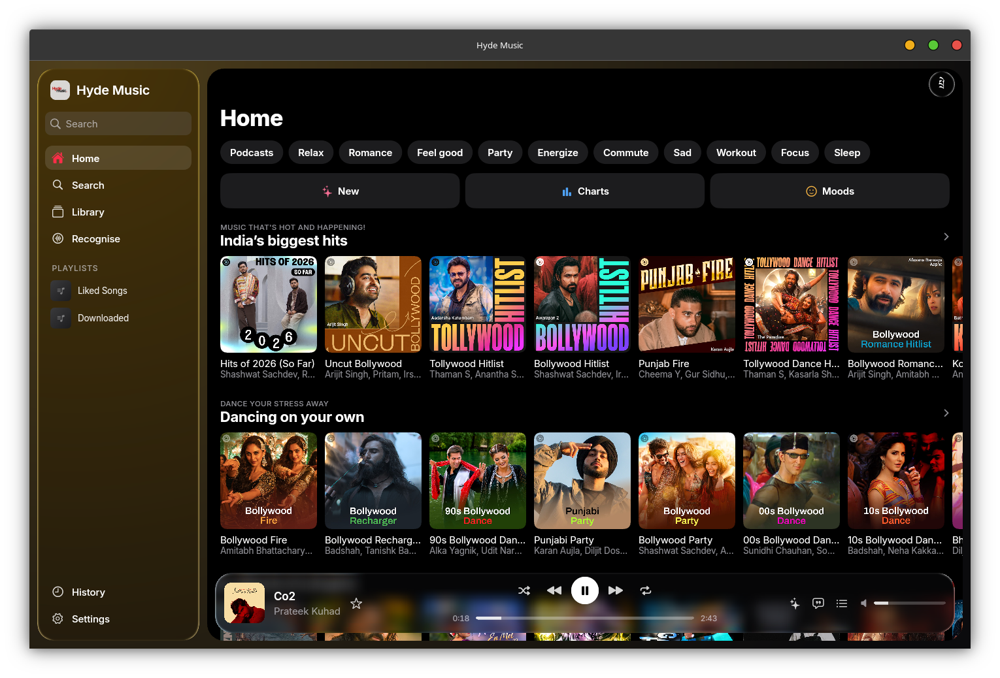
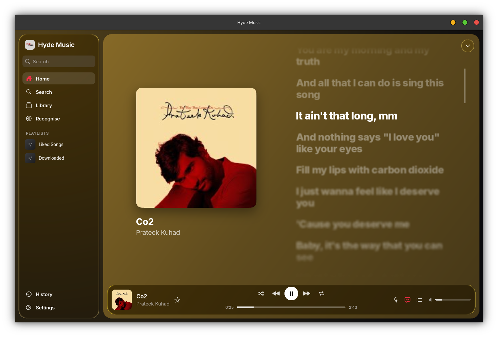
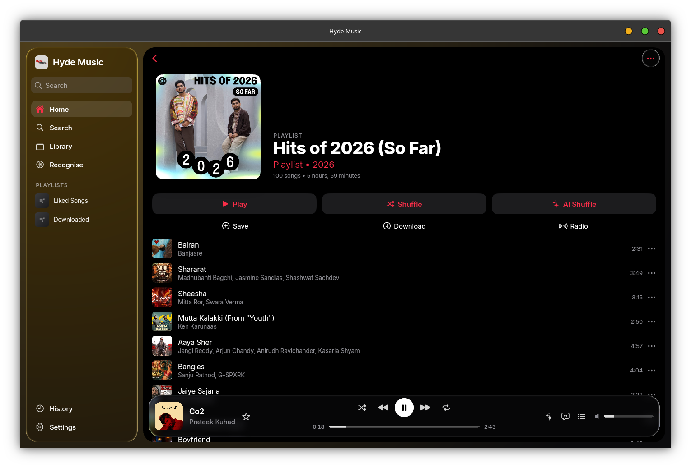

# Hyde Music for Windows & Linux

Free, ad-free music for your computer, with a **Liquid Glass** design, **AI Shuffle**, word-by-word **synced lyrics** and **Suggested Songs**. It's the desktop sibling of [Hyde Music for Android](https://github.com/Hyde-OpenSource/Hyde-Music-Andorid).

<p align="center">
  
</p>

<p align="center">
  
  
</p>

## Download

Get the latest version from **[Releases](https://github.com/Hyde-OpenSource/Hyde-Music-Desktop/releases/latest)**.

| System | File | Notes |
|---|---|---|
| Windows 10 / 11 (64-bit) | `HydeMusic-<version>-windows-x64-Setup.exe` | Installer with Start-menu and desktop shortcuts. Updates itself. |
| Windows, no install | `HydeMusic-<version>-windows-x64-portable.zip` | Unzip anywhere and run `HydeMusic.exe`. |
| Linux (any distro, 2022 or newer) | `HydeMusic-<version>-linux-x86_64.AppImage` | One file, everything included. Updates itself. |
| Linux, with system libmpv | `HydeMusic-<version>-linux-x86_64.tar.gz` | Smaller download. Needs libmpv (see below). |

Every release lists SHA-256 checksums in `SHA256SUMS`.

### Install on Windows
1. Download the **Setup.exe** and run it.
2. If Windows SmartScreen says "Windows protected your PC", click **More info › Run anyway**. Hyde Music isn't signed with a paid Microsoft certificate yet.
3. Follow the installer. Hyde Music opens when it's done.

### Install on Linux (AppImage)
```bash
chmod +x HydeMusic-*-linux-x86_64.AppImage
./HydeMusic-*-linux-x86_64.AppImage
```
You can also right-click the file, enable **Allow executing as program**, and double-click it. To add it to your app menu, use [Gear Lever](https://flathub.org/apps/it.mijorus.gearlever) or AppImageLauncher.

If it doesn't start on an older distro, install FUSE 2 (`sudo apt install libfuse2` on Ubuntu/Debian), or run it with `--appimage-extract-and-run`.

### Install on Linux (tar.gz)
```bash
# 1. libmpv, the audio engine
sudo apt install libmpv2        # Ubuntu 24.04+ / Debian 13   (Ubuntu 22.04: libmpv1)
sudo dnf install mpv-libs       # Fedora (enable RPM Fusion for all codecs)
sudo pacman -S mpv              # Arch / Manjaro
# 2. Hyde Music
tar -xzf HydeMusic-*-linux-x86_64.tar.gz
./HydeMusic/hyde-music
```

## Features

- **Liquid Glass**: a refracting glass sidebar and player bar (Impeller), or a lighter blur in *Settings › Appearance*.
- **AI Shuffle**: each next song follows the last one (artist, album, length), never more than two in a row by one artist. It's in the player bar, the queue, and next to Play on every playlist and album.
- **Suggested Songs** at the bottom of playlists. Click **+** to add one to your own playlist.
- **Synced lyrics**, word by word, with translation, from several providers.
- **Home** with quick picks, mixes, moods, charts and new releases. Press **F5** or the reload button for a fresh feed.
- **Library**: playlists, albums, artists, songs, downloads, history and stats. Import and backup & restore too.
- **Search** songs, albums, artists, videos and playlists, with live suggestions.
- **Recognise** the song that's playing around you (needs a microphone).
- **Discord** rich presence, **Last.fm** scrobbling, **Listen Together**, SponsorBlock.
- **Self-updating** from GitHub releases, with checksum verification.

### Keyboard shortcuts
| Key | Action |
|---|---|
| Space | Play / pause |
| Ctrl + → / ← | Next / previous song |
| Ctrl + ↑ / ↓ | Volume up / down |
| Ctrl + F | Search |
| Ctrl + L | Lyrics |
| Ctrl + Q | Playing Next (queue) |
| F5 | Reload Home |
| Esc | Close lyrics / queue |
| Alt + ← | Back |
| Media keys | Play / pause, next, previous (when the window is focused) |

### Signing in
Sign-in is optional; it adds your YouTube Music library and recommendations. On desktop, go to *Settings › Account › Sign in*, then paste the `cookie` request header from a signed-in music.youtube.com tab (the dialog explains how). It stays on your computer.

## Build from source

See **[docs/BUILDING.md](docs/BUILDING.md)**. Short version:

```bash
flutter pub get
flutter run -d linux        # or: -d windows (on Windows)
packaging/linux/build-appimage.sh   # AppImage + tar.gz into dist/
```

Releases are built by [GitHub Actions](.github/workflows/build.yml) when a `v*` tag is pushed.

## Project layout

| Path | What |
|---|---|
| `lib/engine/hyde_engine.dart` | The one interface the UI talks to |
| `lib/engine/dart/` | The engine, all Dart: InnerTube client, stream resolver, player (just_audio + libmpv), SQLite library, lyrics, downloads, updater, integrations |
| `lib/features/shell/desktop_shell.dart` | Window layout: glass sidebar, pages, player bar, shortcuts |
| `lib/features/player/` | Player bar, Now Playing (lyrics / queue), lyrics engine |
| `lib/design/` | Liquid Glass components and shared widgets |
| `packaging/` | AppImage script, Windows installer script, icons, `.desktop` file |
| `test/` | Unit and widget tests. `test/live` calls real services. `test/screenshots` renders screens to PNG. |

More: [Architecture](docs/ARCHITECTURE.md) · [Design system](docs/DESIGN.md) · [Settings map](docs/SETTINGS.md) · [Changelog](CHANGELOG.md)

## Licence

GPL-3.0, see [LICENSE](LICENSE). Hyde Music is for personal and educational use. Music is streamed from publicly available sources, and Hyde is not affiliated with YouTube or Google.

~ Team Hyde · By Tirth and Hyde OpenSource · [hydeos.tech](https://www.hydeos.tech)
